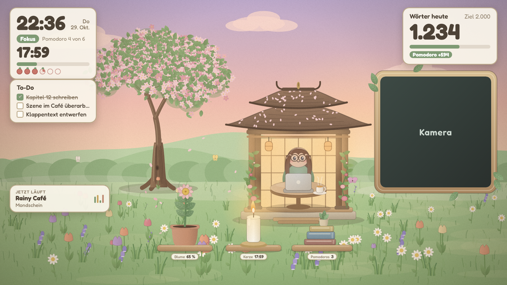
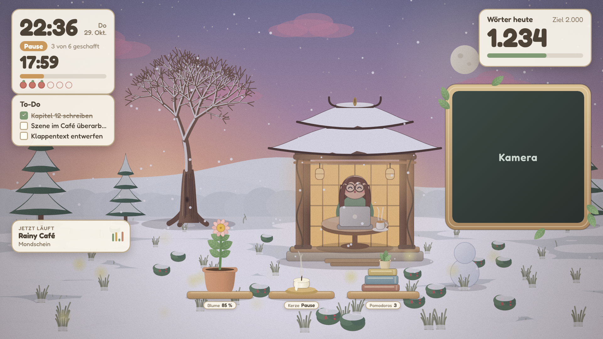
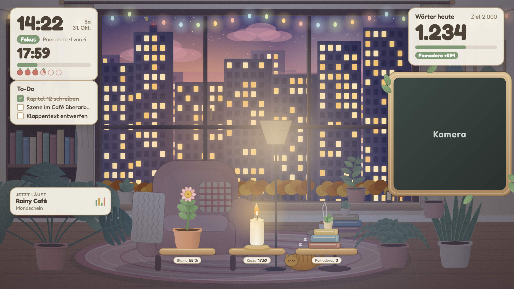
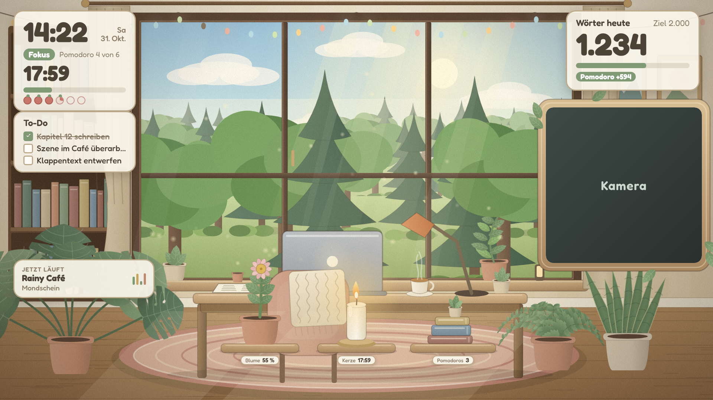
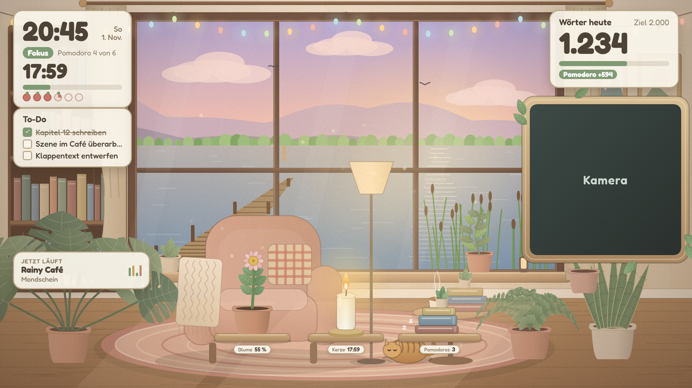
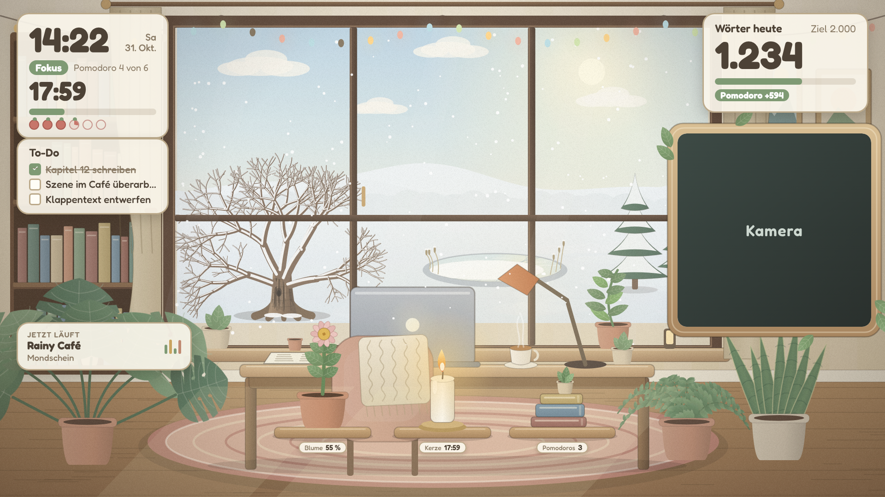

# Novels by Everly – Co-Working-Overlay und Bot für Twitch (läuft lokal, z. B. auf CasaOS)

Ein Overlay für Schreib- und Co-Working-Streams. Der Stream startet mit einer leeren Wiese, und je mehr geschafft wird, desto mehr wächst: Blüten, eine mächtige Eiche, Pilze. Alternativ gibt es eine gemütliche **Fenster-Ansicht** (Leseecke oder Arbeitsplatz mit großem Fenster und wechselndem Ausblick). Dazu gibt es Uhr mit Pomodoro-Timer, Wörterzähler, To-Do-Liste, Musik-Anzeige, ein Kamerafenster und kleine Module wie eine Blume, die mit den Wörtern wächst. Alles läuft als Browser-Quelle in OBS, wird im Browser verwaltet (`/admin/`) und lässt sich dort frei anordnen. Ein Bot unter eigenem Twitch-Konto versteht Chat-Befehle. Der Server läuft als Container im Heimnetz (zum Beispiel auf einem CasaOS-Server), ohne Cloud und ohne öffentliche Adresse.







Fenster-Ansicht (Leseecke und Arbeitsplatz, Stadt, Wald, See und Landschaft, Jahres- und Tageszeit frei wählbar):






## Was es kann

**Wachsende Landschaft.** Die Wiese beginnt leer und wächst mit dem Fortschritt des Tages zu. Im Mittelpunkt steht eine große **Eiche**, dazu ein kleiner **Teich** in der Ecke. Es gibt keine Gebäude und keine Figuren, die Wiese bleibt offen. Auch die fernen Hügel bewachsen mit kleinen Blumen und Flecken, die mit dem Fortschritt erscheinen.

| Jahreszeit | Was passiert |
|---|---|
| Frühling | Blumenwiese mit Gänseblümchen, Tulpen und Glockenblumen. Die Eiche treibt hellgrünes Laub mit Kätzchen aus, Blütenstaub schwebt aus der Krone, im Teich schwimmen Seerosenblätter |
| Sommer | Sonnenblumen, Lavendel, Mohn und Kornblumen, eine dichte Eiche mit Eicheln, Seerosen im Teich, Schmetterlinge und Bienen |
| Herbst | Die Eiche färbt sich bronze und verliert Blatt für Blatt, die Blätter fallen aus der Krone und sammeln sich auf dem Boden. Viele Pilze, Kürbisse und Astern wachsen |
| Winter | Es schneit, am Ende liegt alles unter Schnee: Wiese, Äste und Tannen, der Teich friert zu. Ein Schneemann baut sich auf |

Die **Tageszeit** (Morgengrauen, Mittag, Abend mit Mond, Sternen und Glühwürmchen) und die **Jahreszeit** stellst du im Admin fest ein oder lässt sie nach Datum und Uhrzeit wählen („Auto“).

**Fenster-Ansicht.** Unter *Szene → Darstellung* schaltest du von der wachsenden Landschaft auf ein gemütliches Zimmer mit großem Fenster um. Dort wählst du (Admin → *Fenster-Ansicht*):
- **Ort:** *Gemütliche Leseecke* (Sessel mit Decke und Kissen, Beistelltisch mit dampfendem Tee, Stehlampe, schlafende Katze) oder *Arbeitsplatz* (Schreibtisch mit Laptop, Notizbuch, Tee und Schreibtischlampe)
- **Blick nach draußen:** *Stadt* (Hochhäuser mit erleuchteten Fenstern, nachts blinken rote Lichter), *Landschaft* (Hügel, Eiche, Teich), *Wald* (Nadel- und Laubbäume, Nebel, Lichtstrahlen, abends Glühwürmchen) oder *See* (Berge, Steg, Schilf, Spiegelung von Sonne und Mond)
- **Wetter:** *Auto* (im Winter Schnee, sonst klar), *Klar*, *Regen* (Regen, Tropfen am Glas, Ringe auf dem See) oder *Schnee*

**Jahreszeit** und **Tageszeit** gelten wie bei der Landschaft (fest oder automatisch). Der Ausblick, die Pflanzen und die Farben ändern sich entsprechend: Herbstlaub, Schnee auf den Dächern, zugefrorener See, abends Sterne, Mond und warm leuchtende Lampen. Die Pflanze auf dem Fenstersims wächst mit demselben Fortschritt wie die Landschaft. Uhr, Karten, Module und das Kamerafenster lassen sich auch hier frei anordnen.

**Ziel-Karte.** Sie zeigt, worauf du heute hinarbeitest. Im Admin wählst du die Art:
- **Wörter schreiben** (Stand aus Papyrus, siehe unten)
- **Seiten lesen** (`!seiten 12` im Chat oder im Admin)
- **Streamzeit**: Du gibst vorher an, wie lange du heute streamen willst (z. B. 3 Stunden). Die Karte zeigt die Zeit seit Streambeginn. Läuft dein Twitch-Stream, erkennt das Overlay den Beginn selbst, oder du startest die Zeit von Hand im Admin bzw. mit `!stream start`.
- **Pomodoros**

**Womit die Landschaft wächst**, wählst du getrennt: Ziel-Karte, Streamzeit, Wörter, Pomodoros oder ein Mittel aus Zeit und Ziel. Bei „Streamzeit“ wachsen Blumen und Pflanzen, auch wenn du nichts eingibst.

**Pomodoro.** Dauer, kurze und lange Pause, die Anzahl pro Tag und ob es automatisch weitergeht, stellst du im Admin ein. Die Uhr zeigt Countdown und Fortschrittsbalken, darunter kleine Tomaten für das Tagesziel. Nach der eingestellten Anzahl (Standard 4) gibt es eine lange Pause. Pomodoros lassen sich auch von Hand dazuzählen.

**Module** (einzeln ein- und ausschaltbar, frei verschiebbar):
- **Blume:** vom Keimling bis zur Blüte, wächst mit demselben Fortschritt wie die Landschaft
- **Kerze:** brennt während eines Pomodoros herunter, raucht in der Pause, danach steht eine neue bereit
- **Bücherstapel:** pro geschafftem Pomodoro ein Buch mehr (bis 8)
- **To-Do-Liste:** deine Aufgaben, abgehakt mit Konfetti (anlegen im Admin oder per Chat)
- **Musik:** zeigt Titel, Interpret und Cover (siehe unten)

**Anordnung.** Im Admin unter *Anordnung* ziehst du Uhr, Ziel-Karte, To-Do, Musik, Kamera und Module per Maus an die gewünschte Stelle und stellst ihre Größe ein. Das Bild darüber ist das echte Overlay.

**Kamerafenster (1:1).** Ein quadratischer Rahmen mit durchsichtigem Ausschnitt. **In OBS die Kamera unter das Overlay legen**, dann schaut sie durch das Fenster. Position und Seitenlänge stellst du in der Anordnung ein.

**Zimmer-Modus (pausiert).** Die Szenen mit Tischen, an denen Zuschauer als Chibi-Figuren sitzen (Café, Garten, Park, mit Rängen und freischaltbaren Gegenständen), bleiben im Code erhalten. Unter *Einstellungen → Darstellung* lassen sie sich wieder einschalten. In der Landschaft sind die Befehle dafür ausgeschaltet.

## Musik anzeigen (YouTube Music)

Das Overlay zeigt, was gerade läuft. Es gibt zwei Wege (*Admin → Musik*):

1. **Lokal (am einfachsten):** Die YouTube-Music-Desktop-App (heute *Pear Desktop*, früher „th-ch/youtube-music“) hat ein Plugin „Tuna OBS“. Zusammen mit dem OBS-Plugin [Tuna](https://obsproject.com/forum/resources/tuna.843/) (Quelle „Web browser“, „Host/receive information on local webserver“ mit Port 1608) steht der Titel unter `http://localhost:1608/`. Im Admin *Anzeige: Lokal* und diese Adresse eintragen. Das Overlay liest sie selbst, es muss im OBS auf demselben PC laufen.
2. **Über den Server:** *Anzeige: Server*. Der Titel kommt per Chat (`!song Titel - Interpret`, `!song aus`), von Hand im Admin oder von einem Hilfsprogramm, das `POST /api/musik` aufruft. Das mitgelieferte `scripts/pc-helfer.mjs` liest Tuna und meldet den Titel alle paar Sekunden:

   ```
   SITE_URL=http://casaos-ip:8888 INGEST_TOKEN=dein-schluessel node scripts/pc-helfer.mjs
   ```

Andere Programme, die einen Titel auf einer lokalen Adresse bereitstellen, funktionieren ebenfalls, weil die Antwort tolerant gelesen wird (`title`, `artist(s)`, `cover`/`cover_url`, `status`). Alternativen aus der Recherche: das Windows-Programm *Streamling*, die Browser-Erweiterung *memesound.live* und das OBS-Widget *Now Playing*.

Die Tuna-Adresse und ihre Felder konnte ich nur aus Beschreibungen übernehmen, nicht gegen die laufende App prüfen. Falls der Titel nicht erscheint, einmal `http://localhost:1608/` im Browser öffnen und schauen, was dort steht.

Hinweis: Lizenzierte Musik im Stream kann auf Twitch zu stummgeschalteten Videos oder Verwarnungen führen. Sicherer ist Musik ohne Urheberrechtsprobleme, oder Musik, die nur die Streamerin hört (dann zeigt das Overlay nur den Titel).

## Chat-Befehle

| Befehl | Wer | Wirkung |
|---|---|---|
| `!pomodoro [Min]` · `!pause [Min]` · `!stop` | Moderation, Streamerin | Timer |
| `!pomodoros 6` · `!ziel 1500` | Streamerin | Ziel für heute (Anzahl bzw. Wörter) |
| `!seiten 12` · `!seiten +3` · `!seitenziel 40` | Streamerin | Gelesene Seiten heute und Ziel |
| `!stream start` · `!stream stop` · `!stream ziel 3` | Moderation, Streamerin | Streamzeit starten, beenden, Ziel in Stunden |
| `!task Text` · `!done [Nr]` · `!tasks` | alle | To-Do-Liste (bis zu 3 offene je Person; im Overlay steht die der Streamerin) |
| `!wörter 300` | Zuschauer | gemeldete Wörter zählen für den Chat-Zähler |
| `!wörter 4231` · `!wörter +300` | Streamerin | Stand aus Papyrus bzw. dazugeschrieben |
| `!song Titel - Interpret` · `!song aus` | Moderation, Streamerin | Musik-Anzeige von Hand |
| `!hilfe` | alle | Übersicht |

Nur im Zimmer-Modus: `!sitzen`, `!aufstehen`, `!figur`, `!rang`, `!szene`.

## Einrichtung (CasaOS oder jeder Docker-Rechner)

Der Server ist ein kleiner Node-Container ohne weitere Abhängigkeiten. Er liefert Overlay und Admin aus, speichert alles in `/data` und hält selbst die Verbindung zu Twitch (EventSub per WebSocket). Dafür ruft er Twitch an, es muss also **nichts aus dem Internet auf den Server zugreifen**: keine Portfreigabe, keine Domain, kein Tunnel.

1. **Twitch-App** unter <https://dev.twitch.tv/console/apps> anlegen: Client Type **Public**, OAuth Redirect URL `http://localhost` (wird nicht benutzt, Twitch verlangt aber eine). Die *Client-ID* kopieren, ein Secret braucht es bei „Public“ nicht. Beides trägst du später im Admin unter **Twitch & Chat** ein, nicht in der Compose-Datei.
2. **Container starten.**
   - *CasaOS:* im App Store oben rechts **„Eigene App installieren“** und den Inhalt von `docker-compose.yml` einfügen. Vorher `build: .` durch das fertige Image ersetzen oder das Repository auf dem Server auschecken und dort bauen (siehe unten).
   - *Terminal:* Repository auschecken, in einer Datei `.env` neben der Compose-Datei `ADMIN_PASSWORD=...` eintragen, dann `docker compose up -d --build`.
   - Der Ordner für das Volume (`./data` bzw. in CasaOS z. B. `/DATA/AppData/novelsbyeverly/data`) enthält Einstellungen, Verbindungen und Zählerstände. Das ist alles, was du sichern musst.

   | Variable | Inhalt |
   |---|---|
   | `ADMIN_PASSWORD` | Passwort für `/admin/`, lang wählen |
   | `TWITCH_CLIENT_ID` | optional: Ersatzwert, falls im Admin nichts eingetragen ist (Eingabe im Admin hat Vorrang) |
   | `TWITCH_CLIENT_SECRET` | optional, wie oben; nur bei Client Type „Confidential“ |
   | `INGEST_TOKEN` | optional: Schlüssel für `/api/words` und `/api/musik` (Hilfsprogramme) |
   | `PORT` | optional, Standard 8888 |

3. **Admin öffnen:** `http://CASAOS-IP:8888/admin/`, anmelden, unter **Twitch & Chat** Client-ID (und ggf. Secret) eintragen und „Verbindung prüfen“ klicken.
4. **Kanal mit Twitch verbinden:** Der Admin zeigt einen Code. Auf `twitch.tv/activate` eingeben und bestätigen (am Handy geht auch). Das läuft über den „Device Code“-Ablauf, deshalb braucht der Heimserver keine Weiterleitungs-Adresse.
5. **Bot-Account verbinden:** eigenes Twitch-Konto für den Bot anlegen, im Chat zum **Moderator** machen und über die Schaltfläche verbinden (den Code dabei in einem privaten Fenster mit dem Bot-Konto bestätigen). Ohne Bot-Konto schreibt der Bot unter dem Kanalnamen.
6. **Reward & Verbindung abgleichen** klicken. Die Statusanzeige oben sollte grün sein („Verbindung zu Twitch steht“). Reißt die Verbindung ab, baut der Server sie selbst wieder auf.
7. **OBS:** Browser-Quelle mit `http://CASAOS-IP:8888/overlay` (1920×1080), „Audio über OBS steuern“ aktivieren. Die Kamera darunter legen.
8. Im Admin unter **Overlay** alles an die gewünschte Stelle ziehen sowie Darstellung und Jahres- und Tageszeit wählen. Änderungen werden sofort gespeichert und sind ohne Neuladen im Overlay zu sehen.

Der Timer läuft im Server weiter, auch wenn kein Overlay geöffnet ist (Phasenwechsel und Chat-Ansagen kommen vom Server). Es gibt `GET /healthz` für Überwachung. Der Admin ist nur durch das Passwort geschützt, bitte den Server nicht ins Internet stellen.

### Verwaltung: Aufbau, Sicherung und Update

Der Admin ist in Bereiche gegliedert: *Übersicht* (Pomodoro, Tageswerte, Status), *Overlay* (Anordnung und Szene), *Ziele & Listen*, *Twitch & Chat* (Client-ID und Secret, Verbindungen, Chat), *Einstellungen*, *Community & Test* und *System*. Das Overlay erfährt von Änderungen über einen Live-Kanal (`/api/overlay/live`) sofort; der Abruf alle 3 Sekunden bleibt als Rückfall.

Unter **System** gibt es:

- **Sicherung:** lädt alle Daten als ZIP herunter, wahlweise mit oder ohne Twitch-Zugänge und Secret.
- **Wiederherstellen:** spielt eine Sicherungs-ZIP ein. Vorher legt der Server eine automatische Sicherung des jetzigen Stands an (die letzten 8 bleiben unter `data/backups/`). Fehlen der Sicherung die Zugänge, bleiben die jetzigen erhalten.
- **Update:** nimmt eine ZIP der neuen Version (Ordner `server`, `public` und `package.json`, auch „Download ZIP“ von GitHub mit Oberordner). Der Server prüft die Dateien, sichert die Daten, legt das Update unter `data/app/` ab und startet neu; `restart: unless-stopped` im Compose sorgt dafür, dass er wieder hochkommt. Lässt sich ein Update nicht laden, startet automatisch die eingebaute Version. Notausgang: den Ordner `data/app` löschen oder `COWORK_SAFE=1` setzen. Änderungen am `Dockerfile` oder an `docker-compose.yml` sind so nicht möglich, dafür weiter `docker compose up -d --build`.

## Wortzähler und Papyrus Autor

Papyrus Autor hat nach meiner Recherche keine Schnittstelle, die ein Overlay auslesen könnte. Die Zahl steht in der Statuszeile (Wörter statt Anschläge einstellen) und in der Dokumentstatistik. Deshalb kommt der Wert über eine Schnittstelle, die verschiedene Quellen füttern können:

1. **Von Hand (heute)**: im Admin unter *Landschaft* oder per Chat `!wörter 4231`. Das Overlay zählt die Zahl sanft hoch.
2. **Hilfsprogramm auf dem PC (später)**: liest die Zahl regelmäßig aus der Statuszeile (Barrierefreiheits-Schnittstelle von Windows/macOS oder Texterkennung) und schickt sie an die Schnittstelle:

   ```
   POST http://casaos-ip:8888/api/words
   Authorization: Bearer <INGEST_TOKEN>
   { "absolute": 4231 }     # Stand aus der Statuszeile
   { "delta": 300 }         # nur dazugeschrieben
   ```
3. Einen Tastenanschlag-Zähler (Keylogger) gibt es bewusst nicht: Er wäre ungenau (Löschen, Einfügen, Rückgängig) und ein Datenschutzrisiko.

Der erste Stand des Tages ist der Ausgangspunkt; mit *Heute schon …* lässt sich nachtragen, was vorher schon geschrieben wurde. Der Tag wechselt zur eingestellten Stunde (Standard 5 Uhr).

## Vorschau ohne Twitch

`docs/vorschau.html` per Doppelklick im Browser öffnen: das echte Overlay mit Beispieldaten und Schaltern für Darstellung (Landschaft oder Fenster-Ansicht mit Ort, Blick und Wetter), Jahreszeit, Tageszeit, Wachstum, Pomodoro, Module und Ereignisse. Neu erzeugen nach Änderungen am Overlay: `node scripts/build-vorschau.mjs`.

## Entwicklung

```
npm test                                  # Ende-zu-Ende-Tests mit simulierter Twitch-API und simuliertem WebSocket
ADMIN_PASSWORD=geheim npm start   # http://localhost:8888/admin/
```

Es gibt keine Abhängigkeiten (Node 22 genügt). Daten landen in `./data`. Ohne Client-ID laufen Overlay und Admin trotzdem, nur die Verbindung zu Twitch bleibt aus.

Aufbau:
- `public/overlay.html`: Overlay (Karten, Banner, Konfetti, Ton) · `public/js/wachstum.mjs`: Landschaft, Baum, Teich, Pilze (Jahreszeiten, Tageszeiten, Wachstum) · `public/js/fenster.mjs`: Fenster-Ansicht (Leseecke, Arbeitsplatz, Ausblicke, Wetter) · `public/js/figur.mjs`: Chibi-Figuren (Zimmer-Modus) · `public/js/szene.mjs`: Module, Kamerarahmen und der pausierte Zimmer-Modus · `public/js/malerei.mjs`: Malwerkzeuge · `public/js/layout.mjs`: Standard-Anordnung · `public/js/jetztlaeuft.mjs`: liest Musik-Antworten · `public/js/katalog.mjs`: Figuren, Ränge, Gegenstände
- `public/admin/`: Verwaltung mit Anordnungs-Editor
- `server/index.mjs`: Server (statische Dateien, API, Timer-Takt, Start der Twitch-Verbindung) · `Dockerfile`, `docker-compose.yml`
- `server/routes/`: `overlay` (Stand), `admin`, `auth` (Verbindung mit Twitch per Device-Code), `words-ingest`, `musik-ingest`
- `server/lib/`: `eventsub` (WebSocket-Verbindung zu Twitch, Nachrichten verteilen), `chat` (Befehle), `timer` (Pomodoro), `words`, `pages` (Seiten), `streamzeit`, `tasks`, `musik`, `zeiten` (Jahres- und Tageszeit), `view`, `people` (Zimmer-Modus)

Neues Modul: Schalter in `settings.mjs`, Daten in `view.mjs`, Zeichnen in `drawModules` (`szene.mjs`) und ein Eintrag in `layout.mjs` und `BOXEN` (`public/admin/admin.js`). Neue Jahreszeit oder Pflanze: in `wachstum.mjs` (`PAL`, `MIX` und die Zeichenfunktionen).

Die Grafik ist komplett in Code gemalt (keine Bilddateien). Wer später eigene Illustrationen verwenden möchte, ersetzt die Zeichenfunktionen durch Bilder.

## Hinweise

- Es läuft kein Hintergrundprozess. Timer-Wechsel und Abrechnung holt das Overlay oder der Chat beim nächsten Abruf nach (spätestens nach wenigen Sekunden).
- Wörter, die Zuschauer melden, beruhen auf Vertrauen und zählen nur für den Chat-Zähler.
- Die Daten liegen in JSON-Dateien im Datenordner. Schreibzugriffe sind pro Person getrennt; sehr gleichzeitige Meldungen derselben Person könnten sich theoretisch überschreiben.
