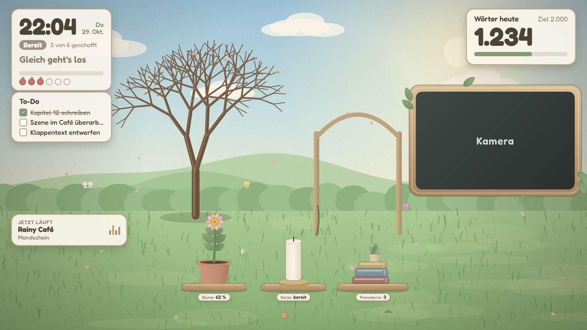
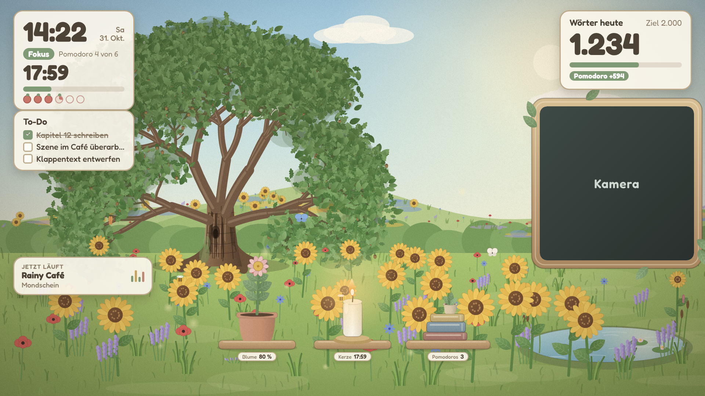
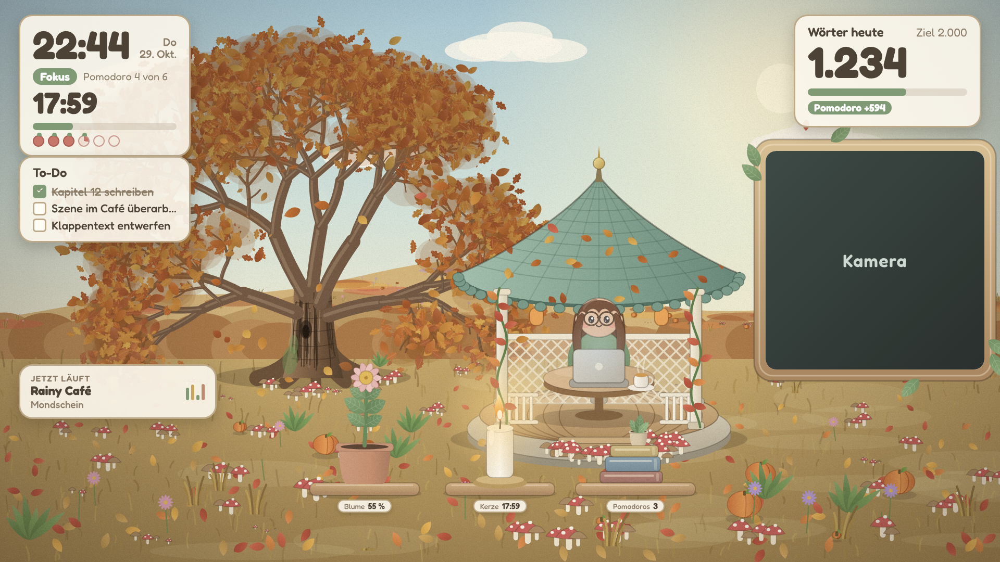

# Novels by Everly – Co-Working-Overlay und Bot für Twitch (Netlify)

Ein Overlay für Schreib- und Co-Working-Streams. Der Stream startet mit einer leeren Wiese, und je mehr geschafft wird, desto mehr wächst: Blüten, ein Baum, Rosen. Stefanie sitzt dabei in einem runden Gartenpavillon unter einer mächtigen Eiche. Dazu gibt es Uhr mit Pomodoro-Timer, Wörterzähler, To-Do-Liste, Musik-Anzeige, ein Kamerafenster und kleine Module wie eine Blume, die mit den Wörtern wächst. Alles läuft als Browser-Quelle in OBS, wird im Browser verwaltet (`/admin/`) und lässt sich dort frei anordnen. Ein Bot unter eigenem Twitch-Konto versteht Chat-Befehle.







## Was es kann

**Wachsende Landschaft.** Die Wiese beginnt leer und wächst mit dem Fortschritt des Tages zu. Im Mittelpunkt stehen eine große **Eiche** und ein **runder Gartenpavillon** mit Kegeldach, in dem Stefanie als kleine Figur sitzt und am Laptop schreibt oder ein Buch liest. Auch die fernen Hügel bewachsen mit kleinen Blumen und Flecken, die mit dem Fortschritt erscheinen.

| Jahreszeit | Was passiert |
|---|---|
| Frühling | Blumenwiese mit Gänseblümchen, Tulpen und Glockenblumen. Die Eiche treibt hellgrünes Laub mit Kätzchen aus, am Pavillon ranken Rosen, Blütenstaub schwebt aus der Krone |
| Sommer | Sonnenblumen, Lavendel, Mohn und Kornblumen, eine dichte Eiche mit Eicheln, Blumenampeln am Pavillon, Schmetterlinge und Bienen |
| Herbst | Die Eiche färbt sich bronze und verliert Blatt für Blatt, die Blätter fallen aus der Krone und sammeln sich auf Boden und Pavillondach. Viele Pilze, Kürbisse und Astern wachsen |
| Winter | Es schneit, am Ende liegt alles unter Schnee: Wiese, Äste, Tannen und Pavillondach (mit Schnee auf dem Kegeldach). Ein Schneemann baut sich auf, das Papierfenster des Pavillons leuchtet warm |

Die **Tageszeit** (Morgengrauen, Mittag, Abend mit Mond, Sternen und Glühwürmchen) und die **Jahreszeit** stellst du im Admin fest ein oder lässt sie nach Datum und Uhrzeit wählen („Auto“).

**Stefanie im Pavillon.** Haare, Frisur, Hautton, Kleidung, Brille, Mütze, Haustier und Getränk stellst du im Admin ein. Beim Fokus tippt sie am Laptop, in der Pause liest sie ein Buch (Blättern, Tee, Dampf). Oder du legst fest, dass sie immer am Laptop sitzt oder immer liest.

**Ziel-Karte.** Sie zeigt, worauf du heute hinarbeitest. Im Admin wählst du die Art:
- **Wörter schreiben** (Stand aus Papyrus, siehe unten)
- **Seiten lesen** (`!seiten 12` im Chat oder im Admin)
- **Streamzeit**: Du gibst vorher an, wie lange du heute streamen willst (z. B. 3 Stunden). Die Karte zeigt die Zeit seit Streambeginn. Läuft dein Twitch-Stream, erkennt das Overlay den Beginn selbst, oder du startest die Zeit von Hand im Admin bzw. mit `!stream start`.
- **Pomodoros**

**Womit die Landschaft wächst**, wählst du getrennt: Ziel-Karte, Streamzeit, Wörter, Pomodoros oder ein Mittel aus Zeit und Ziel. Bei „Streamzeit“ wachsen Blumen und Pflanzen, auch wenn du nichts eingibst.

**Pomodoro.** Dauer, kurze und lange Pause, die Anzahl pro Tag und ob es automatisch weitergeht, stellst du im Admin ein. Die Uhr zeigt Countdown und Fortschrittsbalken, darunter kleine Tomaten für das Tagesziel. Nach der eingestellten Anzahl (Standard 4) gibt es eine lange Pause. Pomodoros lassen sich auch von Hand dazuzählen.

**Module** (einzeln ein- und ausschaltbar, frei verschiebbar):
- **Blume:** vom Keimling bis zur Blüte, wächst mit demselben Fortschritt wie die Landschaft
- **Kerze:** brennt während eines Pomodoros herunter, raucht in der Pause, danach steht eine neue bereit
- **Bücherstapel:** pro geschafftem Pomodoro ein Buch mehr (bis 8)
- **To-Do-Liste:** deine Aufgaben, abgehakt mit Konfetti (anlegen im Admin oder per Chat)
- **Musik:** zeigt Titel, Interpret und Cover (siehe unten)

**Anordnung.** Im Admin unter *Anordnung* ziehst du Uhr, Ziel-Karte, To-Do, Musik, Kamera und Module per Maus an die gewünschte Stelle und stellst ihre Größe ein. Das Bild darüber ist das echte Overlay.

**Kamerafenster (1:1).** Ein quadratischer Rahmen mit durchsichtigem Ausschnitt. **In OBS die Kamera unter das Overlay legen**, dann schaut sie durch das Fenster. Position und Seitenlänge stellst du in der Anordnung ein.

**Gaming-Szene (`/gaming`).** Ein zweites Overlay für Gaming-Streams, als eigene Browser-Quelle (1920×1080) in OBS. Es zeigt die Landschaft (Jahres- und Tageszeit wie im Admin) mit einem dünnen, gemütlichen Holzrahmen um das **Spielfenster im 16:9-Format** (1408×792) und einem **quadratischen Kamerarahmen** (384×384) mit Uhr/Pomodoro und Ziel-Karte darunter. In OBS liegen Spiel-Aufnahme und Kamera **unter** dem Overlay und scheinen durch die ausgeschnittenen Fenster. Mit `?platzhalter=1` siehst du die Fenster, `?teile=uhr,ziel` wählt die Karten, `?demo=1` zeigt Beispieldaten. Die Maße stehen in `public/js/gaming.mjs`.

**Zimmer-Modus (pausiert).** Die Szenen mit Tischen, an denen Zuschauer als Chibi-Figuren sitzen (Café, Garten, Park, mit Rängen und freischaltbaren Gegenständen), bleiben im Code erhalten. Unter *Einstellungen → Darstellung* lassen sie sich wieder einschalten. In der Landschaft sind die Befehle dafür ausgeschaltet.

## Musik anzeigen (YouTube Music)

Das Overlay zeigt, was gerade läuft. Es gibt zwei Wege (*Admin → Musik*):

1. **Lokal (am einfachsten):** Die YouTube-Music-Desktop-App (heute *Pear Desktop*, früher „th-ch/youtube-music“) hat ein Plugin „Tuna OBS“. Zusammen mit dem OBS-Plugin [Tuna](https://obsproject.com/forum/resources/tuna.843/) (Quelle „Web browser“, „Host/receive information on local webserver“ mit Port 1608) steht der Titel unter `http://localhost:1608/`. Im Admin *Anzeige: Lokal* und diese Adresse eintragen. Das Overlay liest sie selbst, es muss im OBS auf demselben PC laufen.
2. **Über den Server:** *Anzeige: Server*. Der Titel kommt per Chat (`!song Titel - Interpret`, `!song aus`), von Hand im Admin oder von einem Hilfsprogramm, das `POST /api/musik` aufruft. Das mitgelieferte `scripts/pc-helfer.mjs` liest Tuna und meldet den Titel alle paar Sekunden:

   ```
   SITE_URL=https://DEINE-SEITE.netlify.app INGEST_TOKEN=dein-schluessel node scripts/pc-helfer.mjs
   ```

Andere Programme, die einen Titel auf einer lokalen Adresse bereitstellen, funktionieren ebenfalls, weil die Antwort tolerant gelesen wird (`title`, `artist(s)`, `cover`/`cover_url`, `status`). Alternativen aus der Recherche: das Windows-Programm *Streamling*, die Browser-Erweiterung *memesound.live* und das OBS-Widget *Now Playing*.

Die Tuna-Adresse und ihre Felder konnte ich nur aus Beschreibungen übernehmen, nicht gegen die laufende App prüfen. Falls der Titel nicht erscheint, einmal `http://localhost:1608/` im Browser öffnen und schauen, was dort steht.

Hinweis: Lizenzierte Musik im Stream kann auf Twitch zu stummgeschalteten Videos oder Verwarnungen führen. Sicherer ist Musik ohne Urheberrechtsprobleme, oder Musik, die nur die Streamerin hört (dann zeigt das Overlay nur den Titel).

## Chat-Befehle

| Befehl | Wer | Wirkung |
|---|---|---|
| `!pomodoro [Min]` · `!pause [Min]` · `!stop` | Moderation, Streamerin | Timer |
| `!pomodoros 6` · `!ziel 1500` | Streamerin | Ziel für heute (Anzahl bzw. Wörter) |
| `!seiten 12` · `!seiten +3` · `!seitenziel 40` | Streamerin | Gelesene Seiten heute und Ziel |
| `!stream start` · `!stream stop` · `!stream ziel 3` | Moderation, Streamerin | Streamzeit starten, beenden, Ziel in Stunden |
| `!task Text` · `!done [Nr]` · `!tasks` | alle | To-Do-Liste (bis zu 3 offene je Person; im Overlay steht die der Streamerin) |
| `!wörter 300` | Zuschauer | gemeldete Wörter zählen für den Chat-Zähler |
| `!wörter 4231` · `!wörter +300` | Streamerin | Stand aus Papyrus bzw. dazugeschrieben |
| `!song Titel - Interpret` · `!song aus` | Moderation, Streamerin | Musik-Anzeige von Hand |
| `!hilfe` | alle | Übersicht |

Nur im Zimmer-Modus: `!sitzen`, `!aufstehen`, `!figur`, `!rang`, `!szene`.

## Einrichtung

1. **Netlify**: Repo verbinden (*Add new site → Import from Git*). Die Build-Einstellungen kommen aus `netlify.toml`, es gibt keinen Build-Befehl.
2. **Twitch-App** unter <https://dev.twitch.tv/console/apps> anlegen:
   - OAuth Redirect URL: `https://DEINE-SEITE.netlify.app/api/auth/callback`
   - Client Type: **Confidential**
3. **Umgebungsvariablen** in Netlify (*Site configuration → Environment variables*), danach neu deployen:

   | Variable | Inhalt |
   |---|---|
   | `TWITCH_CLIENT_ID` / `TWITCH_CLIENT_SECRET` | aus der Twitch-App |
   | `EVENTSUB_SECRET` | beliebiger Zufallstext, 10 bis 100 Zeichen |
   | `ADMIN_PASSWORD` | Passwort für `/admin/`, lang wählen |
   | `INGEST_TOKEN` | optional: Schlüssel für die Schnittstellen `/api/words` und `/api/musik` (Hilfsprogramme) |
   | `SITE_URL` | optional, nur bei eigener Domain |

4. **Admin** öffnen (`/admin/`), anmelden und **Kanal mit Twitch verbinden** (Broadcaster-Konto).
5. **Bot-Account verbinden**: eigenes Twitch-Konto für den Bot anlegen, im Chat zum **Moderator** machen (höhere Nachrichtenlimits) und über die Schaltfläche verbinden. Dafür bei Twitch ausloggen oder ein privates Fenster nutzen, sonst meldet Twitch das Kanal-Konto an. Ohne Bot-Konto schreibt der Bot unter dem Kanalnamen.
6. **Reward & Webhooks abgleichen** klicken. Die Statusanzeige oben sollte grün sein.
7. **OBS**: Browser-Quelle mit `https://DEINE-SEITE.netlify.app/overlay` (1920×1080), „Audio über OBS steuern“ aktivieren. Die Kamera darunter legen.
8. Im Admin unter *Anordnung* alles an die gewünschte Stelle ziehen und speichern, unter *Landschaft* Jahres- und Tageszeit wählen.

## Wortzähler und Papyrus Autor

Papyrus Autor hat nach meiner Recherche keine Schnittstelle, die ein Overlay auslesen könnte. Die Zahl steht in der Statuszeile (Wörter statt Anschläge einstellen) und in der Dokumentstatistik. Deshalb kommt der Wert über eine Schnittstelle, die verschiedene Quellen füttern können:

1. **Von Hand (heute)**: im Admin unter *Landschaft* oder per Chat `!wörter 4231`. Das Overlay zählt die Zahl sanft hoch.
2. **Hilfsprogramm auf dem PC (später)**: liest die Zahl regelmäßig aus der Statuszeile (Barrierefreiheits-Schnittstelle von Windows/macOS oder Texterkennung) und schickt sie an die Schnittstelle:

   ```
   POST https://DEINE-SEITE.netlify.app/api/words
   Authorization: Bearer <INGEST_TOKEN>
   { "absolute": 4231 }     # Stand aus der Statuszeile
   { "delta": 300 }         # nur dazugeschrieben
   ```
3. Einen Tastenanschlag-Zähler (Keylogger) gibt es bewusst nicht: Er wäre ungenau (Löschen, Einfügen, Rückgängig) und ein Datenschutzrisiko.

Der erste Stand des Tages ist der Ausgangspunkt; mit *Heute schon …* lässt sich nachtragen, was vorher schon geschrieben wurde. Der Tag wechselt zur eingestellten Stunde (Standard 5 Uhr).

## Vorschau ohne Twitch

`docs/vorschau.html` per Doppelklick im Browser öffnen: das echte Overlay mit Beispieldaten und Schaltern für Jahreszeit, Tageszeit, Wachstum, Pomodoro, Module und Ereignisse. Neu erzeugen nach Änderungen am Overlay: `node scripts/build-vorschau.mjs`.

## Entwicklung

```
npm install
npm test                                  # Ende-zu-Ende-Tests mit simulierter Twitch-API
ADMIN_PASSWORD=geheim EVENTSUB_SECRET=zufallstext123 node scripts/dev-server.mjs   # http://localhost:8888/admin/
```

Der lokale Server braucht kein Netlify und legt Daten in `./data` ab. Twitch-Funktionen (Chat, Reward) laufen nur auf der veröffentlichten Seite.

Aufbau:
- `public/overlay.html`: Overlay (Karten, Banner, Konfetti, Ton) · `public/js/wachstum.mjs`: Landschaft, Baum, Pavillon, Pilze (Jahreszeiten, Tageszeiten, Wachstum) · `public/js/figur.mjs`: Chibi-Figur (Stefanie und Zimmer-Modus) · `public/js/szene.mjs`: Module, Kamerarahmen und der pausierte Zimmer-Modus · `public/js/malerei.mjs`: Malwerkzeuge · `public/js/layout.mjs`: Standard-Anordnung · `public/js/jetztlaeuft.mjs`: liest Musik-Antworten · `public/js/katalog.mjs`: Figuren, Ränge, Gegenstände
- `public/admin/`: Verwaltung mit Anordnungs-Editor
- `netlify/functions/`: `twitch-webhook` (Chat und Reward), `overlay` (Stand), `admin`, `auth`, `words-ingest`, `musik-ingest`
- `netlify/lib/`: `chat` (Befehle), `timer` (Pomodoro), `words`, `pages` (Seiten), `streamzeit`, `tasks`, `musik`, `zeiten` (Jahres- und Tageszeit), `view`, `people` (Zimmer-Modus)

Neues Modul: Schalter in `settings.mjs`, Daten in `view.mjs`, Zeichnen in `drawModules` (`szene.mjs`) und ein Eintrag in `layout.mjs` und `BOXEN` (`public/admin/admin.js`). Neue Jahreszeit oder Pflanze: in `wachstum.mjs` (`PAL`, `MIX` und die Zeichenfunktionen).

Die Grafik ist komplett in Code gemalt (keine Bilddateien). Wer später eigene Illustrationen verwenden möchte, ersetzt die Zeichenfunktionen durch Bilder.

## Hinweise

- Es läuft kein Hintergrundprozess. Timer-Wechsel und Abrechnung holt das Overlay oder der Chat beim nächsten Abruf nach (spätestens nach wenigen Sekunden).
- Wörter, die Zuschauer melden, beruhen auf Vertrauen und zählen nur für den Chat-Zähler.
- Die Daten liegen in Netlify Blobs. Schreibzugriffe von gleichzeitigen Anfragen sind pro Person getrennt; sehr gleichzeitige Meldungen derselben Person könnten sich theoretisch überschreiben.
