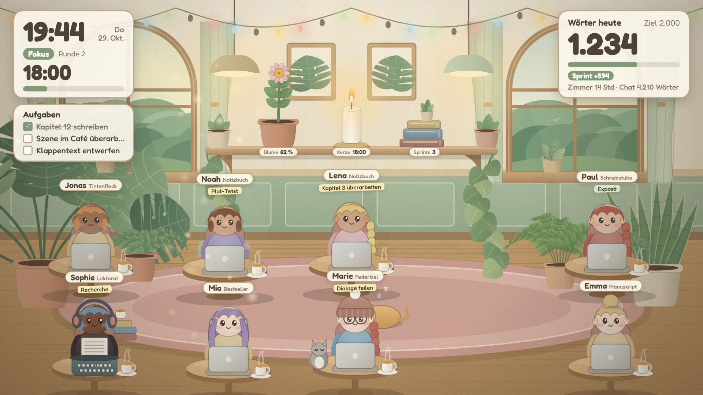
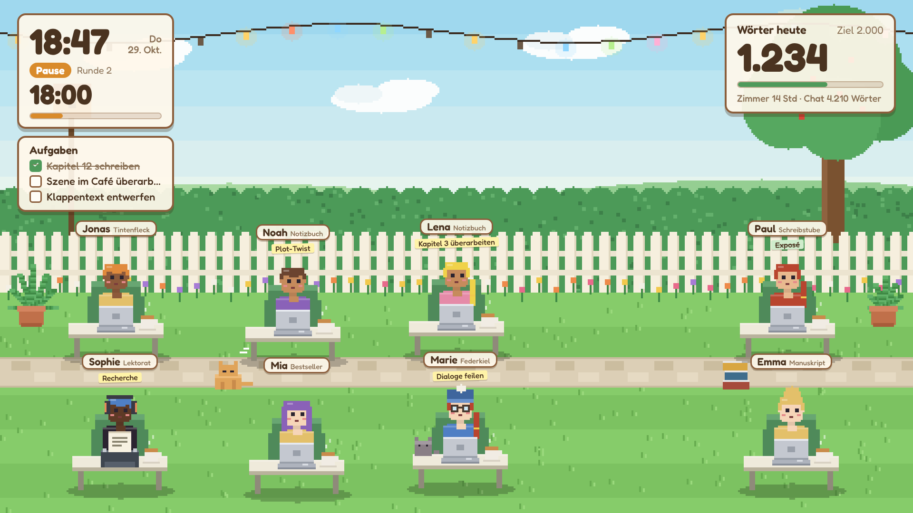
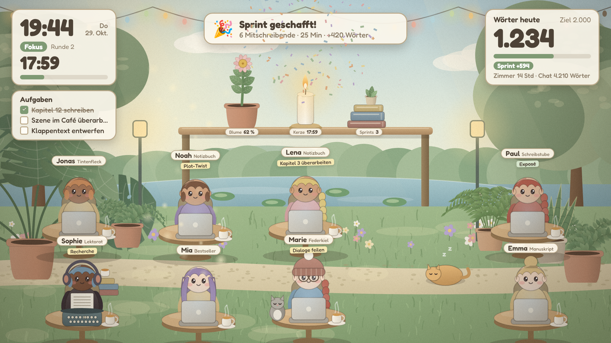

# Novels by Everly – Co-Working-Bot für Twitch (Netlify)

Ein Bot für Co-Working- und Schreib-Streams. Die Zuschauer setzen sich als kleine Figur in eine gemütliche Szene (Café, Garten oder Park), schreiben gemeinsam in Sprints und schalten mit wachsender Arbeitszeit Ränge, Gegenstände und Zimmer-Dekoration frei. Alles läuft als Browser-Quelle in OBS und wird im Browser verwaltet (`/admin/`).





## Was der Bot kann

**Overlay** (`/overlay`, Browser-Quelle 1920×1080)
- **Uhr** mit Sprint-Timer (Fokus und Pause, Fortschrittsbalken, Runde)
- **Wortzähler** der Streamerin mit Tagesziel, der Zahl zählt sichtbar hoch; dazu Sprint-Wörter und die Wörter, die der Chat meldet
- **Aufgabenliste** der Streamerin, abgehakt mit Konfetti. Die Aufgaben der Mitschreibenden hängen als Notizzettel an ihren Namensschildern
- **Szene** mit Figuren: Café, Garten oder Park, 10 Plätze. Beim Fokus tippen die Figuren, in der Pause trinken sie
- **Ereignisse** mit Banner, Konfetti und kleinem Glockenton: Sprint geschafft, Tagesziel, neuer Rang, neuer Gegenstand, Zimmer wächst

Einzelne Teile lassen sich getrennt einbinden, z. B. nur die Karten über einem eigenen Hintergrund: `/overlay?teile=uhr,woerter,tasks`. Ton aus: `&ton=aus`. Vorschau ohne Bot: `/overlay?demo=1`.

**Figur erscheint bei … (im Admin umschaltbar)**
- `!sitzen`: Chatbefehl
- **Check-in**: Kanalpunkte-Reward (Name und Preis einstellbar, Punkte zurück, wenn man schon sitzt oder alles belegt ist)
- **Beides**

**Freischaltungen durch Arbeitszeit.** Als Arbeitszeit zählen die Fokus-Minuten in Sprints, bei denen jemand sitzt. Wer mittendrin aufsteht, bekommt die Zeit bis dahin.

| Persönlich (Rang und Gegenstände) | Ab |
|---|---|
| Rang Tintenfleck → Notizbuch → Federkiel → Schreibstube → Lektorat → Manuskript → Bestseller → Bibliothek → Legende | 0 / 1 / 3 / 6 / 12 / 25 / 50 / 100 / 200 Std |
| Mütze 1 Std · Brille 3 · Kakao 5 · Kopfhörer 6 · Schal 10 · Sonnenbrille 12 · Katze 15 · Blumenkranz 25 · Schreibmaschine 30 · Eule 40 | |

| Gemeinsam (Zimmer wächst mit der Summe aller) | Ab |
|---|---|
| Lichterkette · Pflanzen · Zimmerkatze · Bücherstapel · Vögel & Schmetterlinge · Regenbogen | 2 / 5 / 10 / 20 / 40 / 80 Std |

Alle Schwellen stehen in `public/js/katalog.mjs`. Im Admin lassen sich Freischaltungen abschalten (dann ist alles sofort frei).

## Chat-Befehle

| Befehl | Wer | Wirkung |
|---|---|---|
| `!sitzen` · `!aufstehen` | alle | Figur setzt sich an einen Tisch oder steht auf |
| `!figur` | alle | Figur anpassen: `!figur haare rot`, `!figur frisur lang`, `!figur oberteil blau`, `!figur kopf mütze`, `!figur tier katze`, `!figur zufall`. Ohne Wert zeigt `!figur haare` die Möglichkeiten (Gesperrtes mit Stundenangabe) |
| `!task Text` · `!done [Nr]` · `!tasks` | alle | Aufgaben (bis zu 3 offene, einstellbar) |
| `!wörter 300` | Zuschauer | gemeldete Wörter zählen für den Chat-Zähler |
| `!wörter 4231` · `!wörter +300` | Streamerin | Stand aus Papyrus bzw. dazugeschrieben |
| `!rang` · `!hilfe` | alle | Arbeitszeit und Rang, Befehlsübersicht |
| `!sprint [Min]` · `!pause [Min]` · `!stop` | Moderation, Streamerin | Timer |
| `!szene garten` | Moderation, Streamerin | Szene wechseln |
| `!ziel 1500` | Streamerin | Tagesziel |

Das Befehlszeichen, alle Texte, Zeiten und Limits sind im Admin einstellbar.

## Einrichtung

1. **Netlify**: Repo verbinden (*Add new site → Import from Git*). Die Build-Einstellungen kommen aus `netlify.toml`, es gibt keinen Build-Befehl.
2. **Twitch-App** unter <https://dev.twitch.tv/console/apps> anlegen:
   - OAuth Redirect URL: `https://DEINE-SEITE.netlify.app/api/auth/callback`
   - Client Type: **Confidential**
3. **Umgebungsvariablen** in Netlify (*Site configuration → Environment variables*), danach neu deployen:

   | Variable | Inhalt |
   |---|---|
   | `TWITCH_CLIENT_ID` / `TWITCH_CLIENT_SECRET` | aus der Twitch-App |
   | `EVENTSUB_SECRET` | beliebiger Zufallstext, 10 bis 100 Zeichen |
   | `ADMIN_PASSWORD` | Passwort für `/admin/`, lang wählen |
   | `INGEST_TOKEN` | optional: Schlüssel für die Wörter-Schnittstelle (siehe unten) |
   | `SITE_URL` | optional, nur bei eigener Domain |

4. **Admin** öffnen (`/admin/`), anmelden und **Kanal mit Twitch verbinden** (Broadcaster-Konto).
5. **Bot-Account verbinden**: eigenes Twitch-Konto für den Bot anlegen, dort im Chat zum **Moderator** machen (höhere Nachrichtenlimits) und über die Schaltfläche verbinden. Dafür bei Twitch ausloggen oder ein privates Fenster nutzen, sonst meldet Twitch das Kanal-Konto an. Ohne Bot-Konto schreibt der Bot unter dem Kanalnamen.
6. **Reward & Webhooks abgleichen** klicken. Die Statusanzeige oben im Admin sollte grün sein. Nach jeder Änderung an *Figur erscheint bei* oder am Reward-Namen erneut abgleichen.
7. **OBS**: Browser-Quelle mit `https://DEINE-SEITE.netlify.app/overlay` (1920×1080), „Audio über OBS steuern“ aktivieren.
8. Im Admin unter **Testen** Testfiguren setzen und Ereignisse auslösen, um alles im Overlay zu sehen.

Der Reward „Check-in“ wird von der App angelegt. Gibt es schon einen Reward gleichen Namens, der nicht von der App stammt, bitte vorher umbenennen oder löschen.

## Wortzähler und Papyrus Autor

Papyrus Autor hat nach meiner Recherche keine Schnittstelle, die ein Overlay auslesen könnte. Die Zahl steht in der Statuszeile (Wörter statt Anschläge einstellen) und in der Dokumentstatistik. Deshalb kommt der Wert über eine **Schnittstelle**, die verschiedene Quellen füttern können:

1. **Von Hand (heute)**: im Admin unter *Steuerung* oder per Chat `!wörter 4231`. Das Overlay zählt die Zahl sanft hoch.
2. **Hilfsprogramm auf dem PC (später)**: liest die Zahl regelmäßig aus der Statuszeile (Barrierefreiheits-Schnittstelle von Windows/macOS oder Texterkennung) und schickt sie an die Schnittstelle:

   ```
   POST https://DEINE-SEITE.netlify.app/api/words
   Authorization: Bearer <INGEST_TOKEN>
   { "absolute": 4231 }     # Stand aus der Statuszeile
   { "delta": 300 }         # nur dazugeschrieben
   ```
3. Einen Tastenanschlag-Zähler (Keylogger) gibt es bewusst nicht: Er wäre ungenau (Löschen, Einfügen, Rückgängig) und ein Datenschutzrisiko.

Der erste Stand des Tages ist der Ausgangspunkt; mit *Heute schon …* lässt sich nachtragen, was vorher schon geschrieben wurde. Der Tag wechselt zur eingestellten Stunde (Standard 5 Uhr).

## Vorschau ohne Twitch

Die Datei `docs/vorschau.html` per Doppelklick im Browser öffnen: das echte Overlay mit Beispieldaten, dazu Schalter für Szene, Timer, Figuren und Ereignisse. Neu erzeugen nach Änderungen am Overlay: `node scripts/build-vorschau.mjs`.

## Entwicklung

```
npm install
npm test                                  # Ende-zu-Ende-Tests mit simulierter Twitch-API
ADMIN_PASSWORD=geheim EVENTSUB_SECRET=zufallstext123 node scripts/dev-server.mjs   # http://localhost:8888/admin/
```

Der lokale Server braucht kein Netlify und legt Daten in `./data` ab. Twitch-Funktionen (Chat, Reward) laufen nur auf der veröffentlichten Seite.

Aufbau:
- `public/overlay.html`: Overlay (Karten, Banner, Konfetti, Ton) · `public/js/szene.mjs`: Zeichnen der Szenen und Figuren · `public/js/katalog.mjs`: Figuren, Ränge, Gegenstände, Dekoration
- `public/admin/`: Verwaltung
- `netlify/functions/`: `twitch-webhook` (Chat und Reward), `overlay` (Stand), `admin`, `auth`, `words-ingest`
- `netlify/lib/`: `chat` (Befehle), `people` (Plätze, Arbeitszeit), `timer`, `words`, `tasks`, `view`

Neue Szene: Hintergrund und Dekoanker in `public/js/szene.mjs` ergänzen, Eintrag in `SZENEN` (`katalog.mjs`) und die Tischfarben in `STYLE`. Neue Gegenstände: in `ITEMS` eintragen und in `drawFigure`/`drawDesk` zeichnen.

## Hinweise

- Es läuft kein Hintergrundprozess. Timer-Wechsel und Abrechnung holen das Overlay und der Chat beim nächsten Abruf nach (spätestens nach wenigen Sekunden). Läuft das Overlay nicht und schreibt niemand, wird ein Sprint beim nächsten Aufruf abgerechnet.
- Wer lange nichts im Chat schreibt, verliert den Platz (Standard 120 Minuten). Wörter, die Zuschauer melden, beruhen auf Vertrauen.
- Die Daten liegen in Netlify Blobs. Schreibzugriffe von gleichzeitigen Anfragen sind pro Person getrennt; sehr gleichzeitige Meldungen derselben Person könnten sich theoretisch überschreiben.
